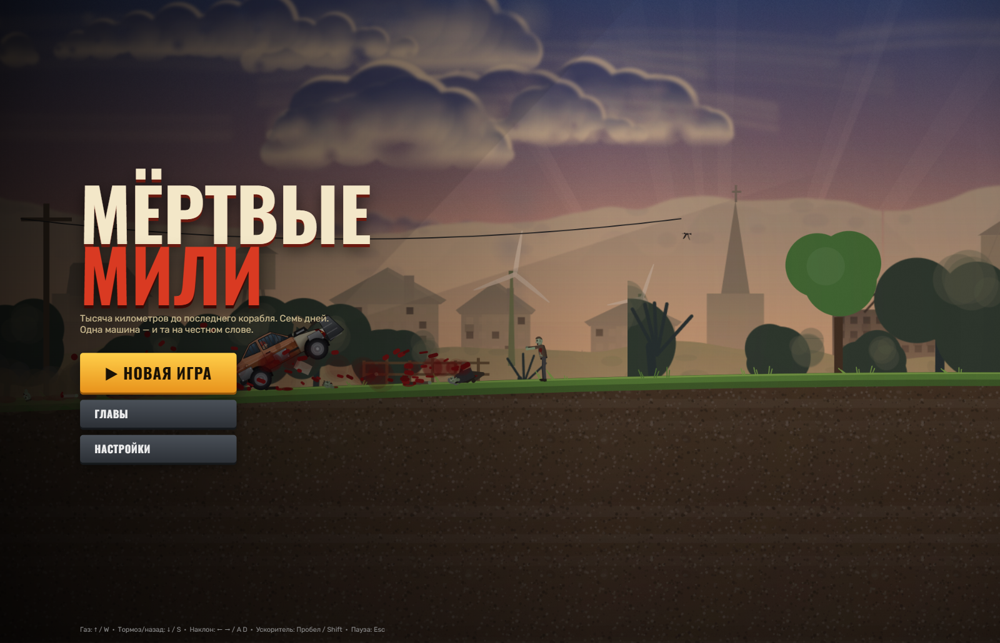

<div align="center">

# 🧟 DEAD MILES

### A zombie-survival driving arcade — cross the wasteland before the fuel runs out

[](LICENSE)
[](#tech-stack)
[](#tech-stack)
[](#run-locally)

[**▶ Play now**](https://1ucomp.github.io/dead-miles/) · [Controls](#controls) · [Run locally](#run-locally) · [Structure](#project-structure) · [License](#license)

</div>



**Dead Miles** (original title *«Мёртвые мили»*) is a side-scrolling driving
arcade about the last working road out of a dead country. Fuel is finite, the
road is not: every kilometre throws zombies, wrecked traffic, raider camps and
weather at you, and the only thing standing between you and the horizon is the
car you keep rebuilding.

Drive, salvage, upgrade, repeat — and try not to stall.

---

## About

You start in a garage with a rusty hatchback and a full tank. You will not keep
either.

Runs are finite: you drive until the fuel gauge hits zero, then everything you
gathered comes back to the garage, where it becomes new suspension, a bigger
tank, armour plating or a bigger gun. The overworld map opens chapter by
chapter, and each chapter ends with a choice that splits the route ahead.

The whole game is client-side JavaScript rendered to a single `<canvas>` —
no engine, no bundler, no dependencies.

## Features

- **10 drivable vehicles** across three classes — cars, bikes and boats:
  *Ржавчик*, *Мул*, *Бультерьер*, *Джаггернаут*, *Носорог*, *Кузнечик*,
  *Цербер*, *Чайка*, *Барракуда* and *Броненосец*.
- **15 hand-authored levels** over **5 chapters**, from a garage co-op at dawn
  to the flight deck of a carrier in a rain storm.
- **Land *and* sea driving** — a real boat model with waves, buoyancy and a
  storm at the lighthouse.
- **Vehicle simulation** you can feel: mass, suspension travel, wheel torque,
  fuel burn and damage per part.
- **Zombies, raiders and hazards** with their own AI, plus roadside props,
  debris and destructible clutter.
- **Weather and time of day** baked into every level — rain, ash, dust, snow,
  fog and thunderstorms change visibility and grip.
- **Passenger escort** on the story route, with its own portrait and dialogue.
- **Persistent garage** — upgrades, unlocks and money survive between runs via
  `localStorage`.
- **Procedural level generation** from a seed, so a route is never twice
  identical.

## Controls

| Action | Keys |
| --- | --- |
| Accelerate | `W` / `↑` |
| Brake · reverse | `S` / `↓` |
| Steer left · right | `A` / `←` · `D` / `→` |
| Pause | `Esc` / `P` |
| Abandon the run (keeps your fuel) | `R` |

Touch controls appear automatically on mobile devices
(throttle, brake, steering and nitro buttons).

## Run locally

There is no build step. Any static file server works:

```bash
git clone https://github.com/1uComp/dead-miles.git
cd dead-miles
```

```bash
# Python
python -m http.server 8080
```

```bash
# Node
npx serve .
```

Then open <http://localhost:8080>.

> Opening `index.html` straight from disk (`file://`) also works in most
> browsers, but a local server is recommended so `localStorage` saves behave
> predictably.

## Play online

**<https://1ucomp.github.io/dead-miles/>**

The site is served directly from the `main` branch of this repository by
GitHub Pages — no build, no deployment pipeline, nothing to configure.

## Project structure

```
dead-miles/
├── index.html          # page shell, script load order, HUD markup
├── css/
│   └── style.css       # layout, HUD, menus, touch controls
└── js/
    ├── main.js         # game loop, input, state machine
    ├── physics.js      # vehicle physics and collisions
    ├── carsim.js       # suspension, torque, fuel burn
    ├── vehicles.js     # the 10 vehicle definitions
    ├── vehicle_art.js  # procedural vehicle drawing
    ├── levels.js       # the 15 level definitions
    ├── leveldata.js    # per-level content tables
    ├── backdrop*.js    # painted backgrounds, marks, scenery
    ├── zombies.js      # zombie AI and spawning
    ├── raiders.js      # raider camps and attacks
    ├── humans.js       # survivor / passenger logic
    ├── props*.js       # roadside props and destructibles
    ├── particles.js    # dust, blood, smoke, debris
    ├── weather.js      # rain, ash, snow, fog, storms
    ├── gauges.js       # speedometer, fuel, damage
    ├── draw.js         # render helpers
    ├── render.js       # frame composition
    ├── ui.js           # menus, garage, map, dialogue
    ├── audio.js        # engine loops and SFX
    └── finish.js       # level end and rewards
```

## Tech stack

| | |
| --- | --- |
| Language | Vanilla ES2020 JavaScript, HTML5, CSS3 |
| Rendering | Single `<canvas>` with 2D context |
| Audio | Web Audio API |
| Storage | `localStorage` |
| Build | **None** — scripts are loaded with plain `<script>` tags |
| Dependencies | **Zero** |

## Localization

The game is written in Russian. An English interface is not shipped yet —
contributions adding `en` strings are welcome under the license terms.

<details>
<summary><b>Русское описание</b></summary>

**«Мёртвые мили»** — аркада про выживание за рулём. Топливо кончается,
дорога — нет: зомби, завалы, рейдеры и непогода. В гараже можно купить
подвеску, бак, броню и оружие, а дальше — всё заново.

**Управление:** `W/↑` — газ, `S/↓` — тормоз, `A/D` или `←/→` — руль,
`Esc`/`P` — пауза, `R` — срвать заезд.

**10 машин** (легковые, мотоциклы, катера), **15 уровней** в **5 главах**,
суша и море, погода, пассажир, сохранение в `localStorage`.

</details>

## License

[PolyForm Noncommercial License 1.0.0](LICENSE)

In short — **free to play, free to learn from, not free to exploit**:

| You may | You may not |
| --- | --- |
| ✅ Play it for personal, non-commercial fun | ❌ Sell it or use it to make money |
| ✅ Study, read and learn from the source | ❌ Redistribute copies outside this repository |
| ✅ Fix bugs and tinker for yourself | ❌ Publish a fork as your own release |
| ✅ Use it in class, a club or a hobby project | ❌ Offer it as a paid product or service |
| ✅ Share links to this repository | ❌ Remove the license or the copyright notice |

The full, legally binding text is in [`LICENSE`](LICENSE).
Anything not granted there is reserved by the author.

---

<div align="center">

Copyright © 2026 **1U.Comp** · All rights reserved

</div>
